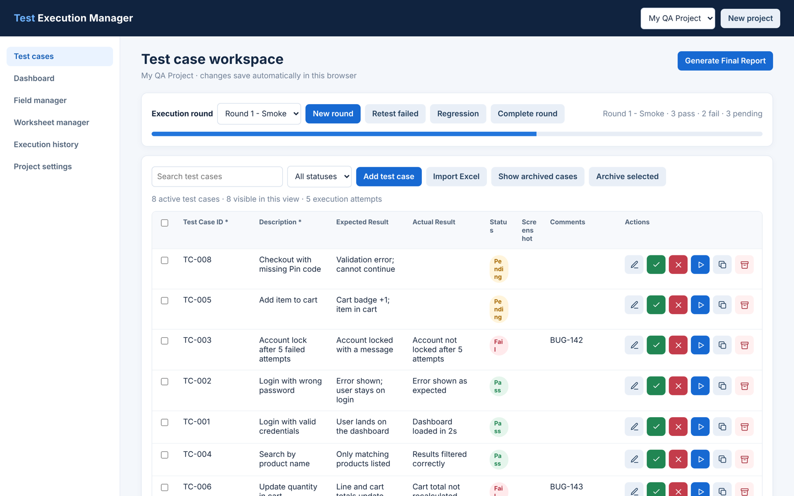
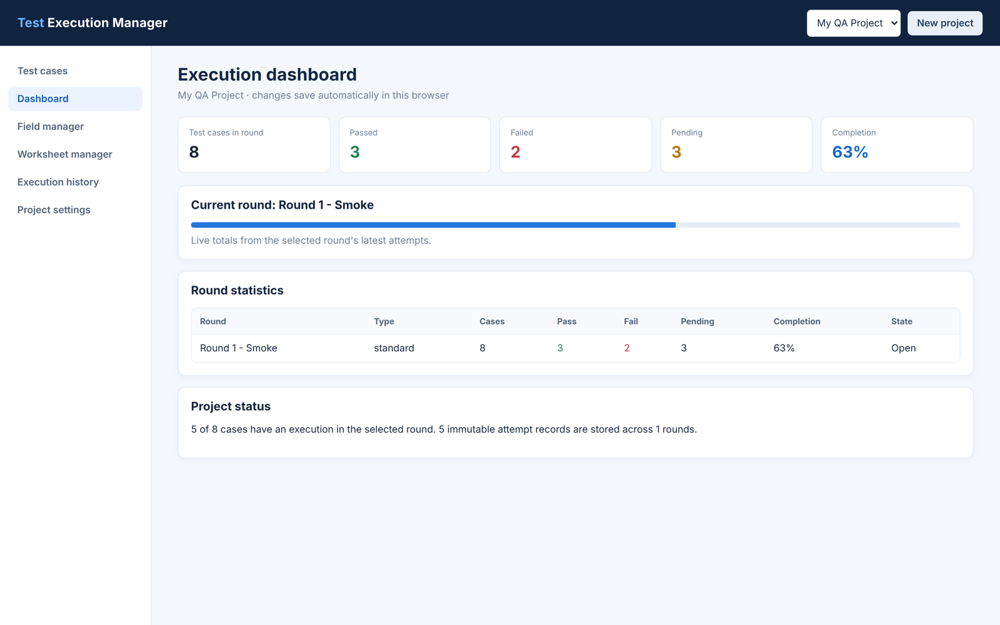

# Test Execution Manager

> Offline, single-file QA test execution manager. Manage test cases, run rounds, retests and regression, capture screenshot evidence, and export Excel and ZIP reports, all in your browser.

A single-file, browser-based tool for QA engineers to manage manual test cases, run them in execution rounds, capture screenshot evidence, and produce a final report as a ZIP with an Excel workbook and an offline evidence viewer.

Everything lives in one HTML file. There's no backend, no build step and no account. Your data stays in your browser's IndexedDB.






---

## Features

### Test case workspace
- Add test cases inline in the table (press **Enter**, or **Tab** out of the last field), or open the full edit dialog.
- Edit, duplicate, archive and restore test cases. Archived cases keep their execution history.
- Search and filter by status (Pending / Pass / Fail), and archive several cases at once.
- Test Case IDs must be unique among active cases.
- Import test cases from an **Excel (.xlsx)** workbook. Each worksheet is read, the header row becomes the fields, and rows are matched by `Test Case ID`: new IDs are added and existing ones are updated.

### Execution rounds
- **New round**: queues every active test case.
- **Retest failed**: queues only the cases that failed in a completed round you choose.
- **Regression**: queues every active case again under a regression round.
- Mark a case **Pass** or **Fail** quickly, or **Execute with evidence** to record the actual result, comments and screenshots.
- Every save creates a new, numbered attempt (Attempt 1, 2, …). Earlier attempts are never overwritten, and each one stores a snapshot of the test case as it was at that moment.
- **Complete round** locks the round. It can only be completed when every case in it has a result.

### Screenshot evidence
- Upload images, drag and drop them, paste with **Ctrl+V**, or use the **Paste from clipboard** button.
- Up to 15 MB per image. Images are stored as binaries in IndexedDB.
- Files get predictable names: `<TestCaseID>_<Round>_Attempt<N>_<NNN>_<id>.<ext>`.

### Dashboard and history
- **Dashboard**: pass, fail and pending counts, completion % for the selected round, and stats for every round.
- **Execution history**: every attempt across all rounds, filterable by round, status, Test Case ID, any custom field value, and date. Evidence opens in a new tab.

### Configurable fields and worksheets
- **Field manager**: add, rename, reorder, archive and restore fields. Supported types are `text`, `longtext`, `number`, `date`, `dropdown`, `multiselect` and `checkbox`. Field IDs stay the same when you rename a label, so historical data stays linked.
- **Worksheet manager**: set up the worksheets used in the exported Excel report, including sheet order, column order and headers, column visibility, and which field each column maps to.

### Projects, backup and restore
- Run several independent projects and switch between them from the top bar.
- Rename, archive or delete a project.
- **Export project backup**: one JSON file holding cases, fields, worksheets, rounds, attempts and screenshot binaries.
- **Import project backup**: restores the backup as a *new* project. It never overwrites existing data.

### Final report (ZIP)
**Generate Final Report** downloads `<Project>_Test_Execution_Report.zip`, which contains:

| File | Contents |
|---|---|
| `Test_Execution_Report.xlsx` | Project Summary, Test Case Master, your configured worksheets, one sheet per round with all attempts, and a full Execution History sheet. Headers are styled, rows are frozen and filtered, and status cells are color-coded. |
| `EvidenceViewer.html` | A standalone, searchable offline viewer for test cases, rounds, attempt history and screenshot thumbnails. It needs no app, server or internet connection. |
| `Evidence/<Round>/…` | Every screenshot, organized by round. The workbook and viewer refer to them by relative path. |
| `README.txt` | Short instructions for whoever receives the report. |

---

## Getting started

### Requirements
- A modern browser (Chrome, Edge, Firefox or Safari).
- Internet access the first time each session loads, to fetch two libraries from jsDelivr:
  - [ExcelJS 4.4.0](https://github.com/exceljs/exceljs), used for Excel import and export
  - [JSZip 3.10.1](https://github.com/Stuk/jszip), used to build the report ZIP

  The rest of the app works without them. Only Excel import and report generation need them.

### Run locally (recommended)
Browsers handle IndexedDB storage unevenly for pages opened with `file://`, so serve the file from a local web server:

```bash
git clone https://github.com/imsrj57/test-management-qa.git
cd test-management-qa
python -m http.server 8000      # on Windows you can also use: py -m http.server 8000
```

Then open **http://localhost:8000/Test_Execution_Manager.html**. Press **Ctrl+C** to stop the server.

You can also just double-click `Test_Execution_Manager.html`, but storage may not persist in every browser.

### First run
On first launch the app creates a project called **My QA Project** with these default fields:

`Test Case ID*` · `Description*` · `Expected Result` · `Actual Result` · `Status` · `Screenshot` · `Comments`

(* = required)

---

## Workflow at a glance

```
 Set up project ─► Configure fields ─► Add / import test cases
                                              │
                                              ▼
                                  Create execution round (Round 1)
                                              │
                                              ▼
                         Execute each case: Pass / Fail + actual result
                                + comments + screenshots
                                              │
                                              ▼
                              Complete round (locks results)
                                              │
                         ┌────── any failures? ──────┐
                        yes                          no
                         ▼                            │
               Developers fix defects                 │
                         ▼                            │
           "Retest failed" round (only failed cases)  │
                         ▼                            │
              Execute ─► Complete (repeat if needed)  │
                         └─────────────┬──────────────┘
                                       ▼
                   "Regression" round (all active cases)
                                       ▼
                     Execute ─► Complete ─► Generate Final Report (ZIP)
                                       ▼
                             Export project backup (JSON)
```

---

## Example test cases

[`samples/sample_test_cases.xlsx`](samples/sample_test_cases.xlsx) holds 15 ready-to-import test cases for a typical e-commerce web app. The app imports these columns: `Test Case ID`, `Module`, `Priority`, `Description`, `Pre-conditions`, `Test Steps` and `Expected Result`. Columns that aren't default fields (Module, Priority, Pre-conditions, Test Steps) are created as new fields automatically.

| Test Case ID | Module | Priority | Description | Expected Result |
|---|---|---|---|---|
| TC-001 | Login | High | Login with valid credentials | User is redirected to the dashboard |
| TC-002 | Login | High | Login with wrong password | "Invalid email or password" error; user stays on login page |
| TC-003 | Login | Medium | Login with empty fields | Required-field validation messages are shown |
| TC-004 | Login | Medium | Account lock after 5 failed attempts | Account is locked and a lock message is shown |
| TC-005 | Login | Low | Logout | User is logged out and sent to the login page |
| TC-006 | Registration | High | Register a new user | Account created; confirmation email sent |
| TC-007 | Registration | Medium | Register with an existing email | "Email already in use" error |
| TC-008 | Search | High | Search by product name | Results list only matching products |
| TC-009 | Search | Low | Search with no results | "No products found" message |
| TC-010 | Cart | High | Add item to cart | Cart badge +1; item appears in cart |
| TC-011 | Cart | Medium | Update item quantity in cart | Line total and cart total update correctly |
| TC-012 | Cart | Medium | Remove item from cart | Item removed; cart shows as empty |
| TC-013 | Checkout | High | Checkout with valid address | Payment step shown with correct total |
| TC-014 | Checkout | High | Checkout with missing address fields | Validation error on Pin code; can't continue |
| TC-015 | Profile | Low | Update profile name | Success toast; new name displayed |

---

## End-to-end workflow (walkthrough using the sample)

### Step 1: Open the app and set up the project
1. Start the local server and open `http://localhost:8000/Test_Execution_Manager.html`.
2. Go to **Project settings** and rename *My QA Project* to something like `ShopApp v2.3 – Release Testing`.
3. Need another release or app? Click **New project** in the top bar. Each project has its own cases, rounds and evidence.

### Step 2: Configure fields (optional)
1. Open **Field manager**.
2. Click **Add field** for anything you track, such as *Module* (dropdown: Login, Cart, …), *Priority* (dropdown: High, Medium, Low) or *Test Steps* (longtext).
3. Use ↑/↓ to reorder fields, **Configure** to rename a field, change whether it's required, or edit its options, and **Archive** to hide a field without losing its data.

> If you import the sample workbook, missing fields are created for you as `text` fields. You can change them to dropdowns later in **Field manager**.

### Step 3: Add test cases
Choose one:
- **Import:** in **Test cases**, click **Import Excel** and pick `samples/sample_test_cases.xlsx`. A message confirms *"Imported 15 new case(s)…"*. Re-importing the same file later updates cases by `Test Case ID` instead of duplicating them.
- **Manual:** type in the empty last row of the table and press **Enter**. Or click **Add test case** to use the full form.
- **Duplicate:** click the copy icon on an existing case. The new case gets the ID `TC-001-COPY`, which you can then edit.

### Step 4: Create the first execution round
1. In **Test cases**, click **New round** and name it `Round 1 – Smoke`.
2. All 15 active cases are queued as *Pending*, and a progress bar appears.

### Step 5: Execute the test cases
For each case, do one of the following:
- Click ✔ **Mark pass** or ✖ **Mark fail**. The execute dialog opens with that status already selected.
- Click ▶ **Execute with evidence** to choose the status yourself.

In the dialog:
1. **Actual result** (required), for example *"Dashboard loaded in 2s"*.
2. **Status**: Pass or Fail.
3. **Screenshots**: upload them, drag them in, or press Win+Shift+S and then **Ctrl+V** in the paste area.
4. **Comments**, for example *"Defect BUG-142 raised"*.
5. Click **Save attempt**.

Example results for Round 1:

| Test Case ID | Status | Actual Result | Comments |
|---|---|---|---|
| TC-001 | Pass | Dashboard loaded | – |
| TC-002 | Pass | Error shown as expected | – |
| TC-004 | **Fail** | Account not locked after 5 attempts | BUG-142 |
| TC-011 | **Fail** | Cart total not recalculated | BUG-143 |
| TC-014 | **Fail** | Form submitted with empty Pin code | BUG-144 |
| … others | Pass | As expected | – |

If you execute the same case again in the same round, the app saves it as **Attempt 2**. Attempt 1 is kept.

### Step 6: Track progress
- **Dashboard** shows the totals: in this example, 15 cases · 12 passed · 3 failed · 0 pending · 100%.
- **Execution history** lists every attempt. Filter by round, status, Test Case ID, date, or any field (for example *Module = Cart*), and click an evidence link to view the screenshot.

### Step 7: Complete the round
Click **Complete round**. This only works when no cases are pending. After that, the round is **locked** and can't be changed, so the record is trustworthy for audits.

### Step 8: Retest the failed cases
1. Once the developers fix BUG-142, BUG-143 and BUG-144, click **Retest failed**.
2. Choose `Round 1 – Smoke` as the source round. The new round, `Retest 1`, contains only TC-004, TC-011 and TC-014.
3. A **Previous result** column shows each case's status from Round 1.
4. Execute the three cases and **Complete round**. If something still fails, run another retest from `Retest 1`.

### Step 9: Run regression
Click **Regression** to re-run every active case, so you can confirm the fixes didn't break anything else. Execute the cases, then **Complete round**.

### Step 10: Generate and share the final report
1. Click **Generate Final Report** at the top of **Test cases**.
2. This downloads `ShopApp_v2_3_Release_Testing_Test_Execution_Report.zip`:
   - `Test_Execution_Report.xlsx` has these sheets: Project Summary, Test Case Master, your configured worksheets, one sheet per round (*Round 1 – Smoke*, *Retest 1*, *Regression*), and Execution History.
   - `EvidenceViewer.html` lets stakeholders search the results and click screenshot thumbnails offline.
   - `Evidence/<Round>/TC-004_Round_1_Smoke_Attempt1_001_xxxx.png` and so on hold the screenshots.
3. Share the ZIP with your lead, developers or client.

> Before you generate the report, you can choose which sheets and columns the Excel file contains in **Worksheet manager**. For example, add a "Client View" sheet with only ID, Description, Expected Result and Status.

### Step 11: Back up
In **Project settings**, click **Export project backup** to save a `.json` file. To move to another machine or browser, click **Import project backup** there. The backup is restored as a separate project.

---

## Excel import format

- Only `.xlsx` files are supported. Legacy `.xls` files are not.
- Row 1 of each worksheet is the header row. Headers that match an existing field label (case-insensitive) map to that field. Any other header creates a new `text` field.
- Include a `Test Case ID` column so rows can be matched for updates. Rows without one get an auto-generated ID, `<SheetName>-<row>`.
- Empty rows are skipped.

Example:

| Test Case ID | Description | Expected Result | Module | Priority |
|---|---|---|---|---|
| TC-001 | Login with valid credentials | User lands on dashboard | Auth | High |
| TC-002 | Login with wrong password | Error message is shown | Auth | Medium |

---

## Data storage and privacy

- All data stays **in your browser** in an IndexedDB database named `TestExecutionManager`. Nothing is uploaded anywhere.
- Clearing site data, or using a different browser, profile or URL (for example `localhost:8000` vs `file://`), means you'll see a different, empty database.
- **Export backups regularly**, especially before clearing browser data or switching machines.
- If the browser runs out of storage, the app shows a warning. Export a backup and remove unused evidence to free space.

---

## Project structure

```
test-management-qa/
├── Test_Execution_Manager.html   # the entire application (HTML + CSS + JS)
├── samples/
│   └── sample_test_cases.xlsx    # 15 example test cases ready to import
└── README.md
```

### Under the hood
- Plain JavaScript in a single IIFE, with no framework.
- IndexedDB object stores: `projects`, `cases`, `fields`, `worksheets`, `rounds`, `attempts`, `evidence`, `evidenceBinary` and `settings`. Each store is indexed by `projectId`.
- Each execution is saved in one transaction across attempts, evidence and the case, so a failed save doesn't leave partial records.
- User content is HTML-escaped before rendering.

---

## Limitations

- Single user, single browser. There's no sync or collaboration. Share data by exchanging backup JSON files or report ZIPs.
- Excel import and report generation need internet access to load ExcelJS and JSZip from the CDN.
- Opening the app via `file://` may not keep data in some browsers. Use a local server.

---

## Contributing

Issues and pull requests are welcome. Because the app is one file, make your changes in `Test_Execution_Manager.html` and test them by serving it locally as described above.

## License

[MIT](LICENSE)
